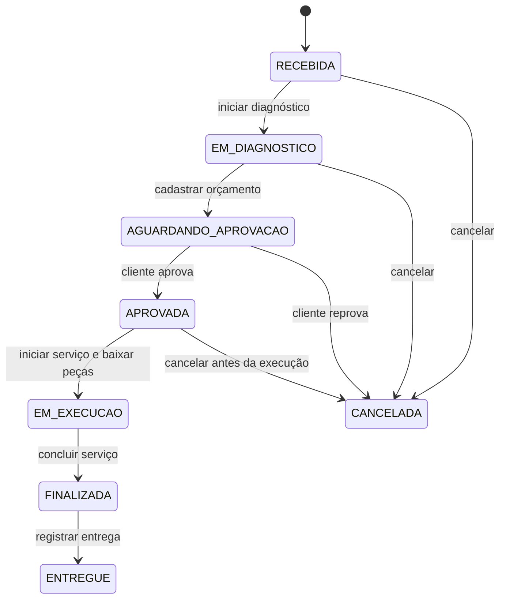
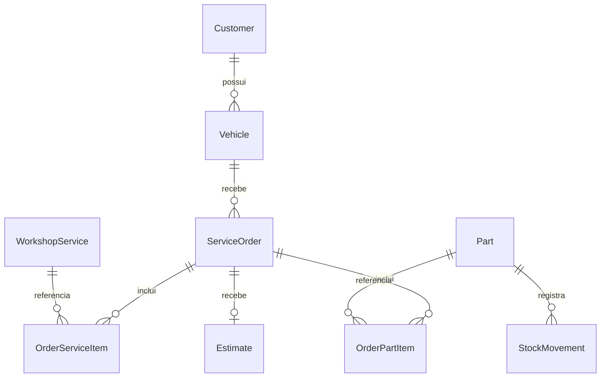

# DDD da solução entregue

A visão de arquitetura está nos [diagramas C4 — níveis 1 a 3](../arquitetura/README.md), com acesso ao arquivo disponibilizado pelo grupo no Google Drive.

Sistema de atendimento de oficina: identificar cliente e veículo, receber OS, diagnosticar, orçar, obter autorização, executar e entregar. A documentação local representa o código atual; o [quadro original no Miro](https://miro.com/app/board/uXjVGE0G3xk=/) é a referência de descoberta, não uma declaração de que todas as ideias do brainstorming foram implementadas.

## Domain Storytelling

Os [diagramas originais de Domain Storytelling](storytelling/README.md) apresentam três histórias do processo da oficina:

- [Atendimento e orçamento](storytelling/01-atendimento.svg): cadastro, abertura da OS, diagnóstico e decisão do cliente.
- [Fluxo do mecânico](storytelling/02-fluxo-mecanico.svg): consulta da OS aprovada, solicitação de peças, execução e finalização.
- [Estoque](storytelling/03-estoque.svg): consulta, disponibilidade, reserva, entrega e saída de peças.

A página de Storytelling explica a relação entre as histórias e o código, incluindo as atividades de reserva e entrega física de peças que não possuem operação própria na aplicação. Foi incluída uma versão SVG por história, sem repetir as exportações PNG.

## Event Storming

O Event Storming organiza o atendimento da oficina em eventos de negócio, comandos, políticas e agregados. O fluxo abrange cadastro de cliente e veículo, abertura da OS, diagnóstico, orçamento, decisão do cliente, disponibilidade de peças, execução e entrega.

Consulte o [quadro de Event Storming no Miro](https://miro.com/app/board/uXjVGE0G3xk=/) e a [síntese do fluxo e das regras de negócio](event-storming/README.md).

## Contextos e agregados

O MVP é um monólito em camadas. Os contextos abaixo são limites conceituais, não módulos implantados separadamente. Os nomes no código permanecem em inglês; os estados e o vocabulário de atendimento são em português.

| Contexto | Agregados / entidades | Responsabilidade |
|---|---|---|
| Cadastro | Customer; Vehicle | Identidade cadastral e relação cliente-veículo |
| Atendimento e execução | ServiceOrder; OrderServiceItem; OrderPartItem; Estimate | Itens, valores, diagnóstico, autorização e sequência de estados |
| Catálogo | WorkshopService | Serviços ativos e preços atuais |
| Estoque | Part; StockMovement | Saldo, SKU e trilha de movimentações |
| Identidade e acesso | User | Funcionário, papel, senha com hash e JWT |

`ServiceOrder` é a raiz do agregado de atendimento. Seus itens têm preços capturados na criação do orçamento; alterações posteriores no catálogo não mudam o total aprovado. `Estimate` é dependente da OS, com uma única decisão. `Part` protege o saldo não negativo; o repositório acrescenta controle de concorrência para proteger a regra entre requisições simultâneas.

### Identificação de peças no estoque

O **SKU (Stock Keeping Unit)** é o código interno de um tipo de peça ou insumo, armazenado em `Part.Sku`. Por exemplo, dez filtros iguais podem ter SKU `FIL-OLEO-BOSCH-X` e saldo `10` em um único cadastro. Produtos diferentes devem receber códigos distintos; o SKU não identifica cada unidade física e não precisa ser um código de barras.

O SKU é obrigatório e único no cadastro de peças. A aplicação verifica duplicidade, e o banco mantém um índice único. As OS e movimentações referenciam o `Part.Id` (GUID); o SKU é a identificação de negócio do produto. Entradas e saídas alteram o saldo do cadastro existente, sem exigir um novo SKU para cada reposição.

### Objetos de valor e validações

`DocumentNumber` representa CPF/CNPJ numérico válido, normalizado e imutável. `LicensePlate` representa a placa validada e normalizada. São usados na criação/busca/alteração cadastral. Na API e no banco são serializados como strings; isso é uma decisão do MVP para preservar contratos e esquema. As entidades ainda têm algumas propriedades públicas para materialização e cadastro; não se afirma um modelo de domínio totalmente encapsulado.

### Eventos, comandos e políticas no código

Os eventos deste documento nomeiam fatos de negócio observáveis. O MVP os realiza por métodos e persistência transacional; não implementa um barramento de eventos, Event Sourcing ou classes para cada evento. Essa distinção evita confundir o modelo de descoberta com uma arquitetura distribuída.

| Comando / ação | Evento de negócio | Implementação / política |
|---|---|---|
| Cadastrar cliente | Cliente cadastrado | CustomerUseCases; documento único e válido |
| Cadastrar veículo | Veículo cadastrado | VehicleUseCases; cliente existente e placa única |
| Abrir OS | Ordem de serviço recebida | ServiceOrderUseCases.CreateOrder; estado RECEBIDA |
| Iniciar diagnóstico | Diagnóstico iniciado | ChangeStatus + ServiceOrder.Transition |
| Cadastrar orçamento | Orçamento gerado | EstimateUseCases.Create; preços do catálogo; AGUARDANDO_APROVACAO |
| Processar e-mail | Orçamento enviado | EstimateEmailWorker; EmailSentAt após aceite SMTP |
| Aprovar / reprovar | Decisão registrada | Estimate.Decide; validade, uso único, APROVADA/CANCELADA |
| Reemitir | Novo link emitido | Estimate.Reissue; revoga token anterior sem alterar valores |
| Iniciar serviço | Execução iniciada e peças consumidas | ServiceOrderUseCases; saldo suficiente, movimento e estado na mesma gravação |
| Concluir serviço | Serviço finalizado | Transition; FinishedAt e cálculo de tempo médio |
| Registrar entrega | Veículo entregue | Transition; DeliveredAt |
| Ajustar estoque | Movimento registrado | InventoryUseCases; delta não nulo, motivo, saldo válido |

### Transações e concorrência

- EF Core grava todas as alterações de um `SaveChanges` em transação. Orçamento + itens + estado + mensagem pendente são uma unidade; decisão + estado também.
- `Part.Quantity` e `ServiceOrder.Status` são tokens de concorrência. O UPDATE usa o valor lido originalmente; gravação concorrente obsoleta falha e reverte toda a unidade, incluindo os movimentos.
- `Estimate.Version` protege duas decisões/reemissões concorrentes. HTTP 409 pede nova consulta, sem repetir automaticamente uma intenção do cliente.
- A entrega SMTP ocorre depois do commit. O corpo pendente no banco permite novas tentativas a cada 30 segundos. Não há transação distribuída com SMTP: a entrega é pelo menos uma vez e pode repetir após uma interrupção.

## Máquina de estados

## Relacionamentos

## Limites de escopo

Os seis estados mínimos do enunciado existem; APROVADA e CANCELADA detalham a decisão. Ações de diagnóstico/execução/entrega ainda usam a rota de status com regras de transição e papéis; orçamento e decisão possuem rotas específicas e não podem ser contornados por essa rota.

O Miro original inclui reserva, fornecedor, entrega física de peças e pendência por falta de estoque. O código entrega controle de saldo e movimentos, bloqueio da execução sem estoque e reposição manual. Não há reserva/fornecedor nem aprovação de reparos adicionais por versões de orçamento. Esses itens não aparecem como funcionalidades obrigatórias detalhadas da Fase 1; não devem ser demonstrados como implementados.

Glossário e linguagem ubíqua: [linguagem-ubiqua.md](linguagem-ubiqua.md).
